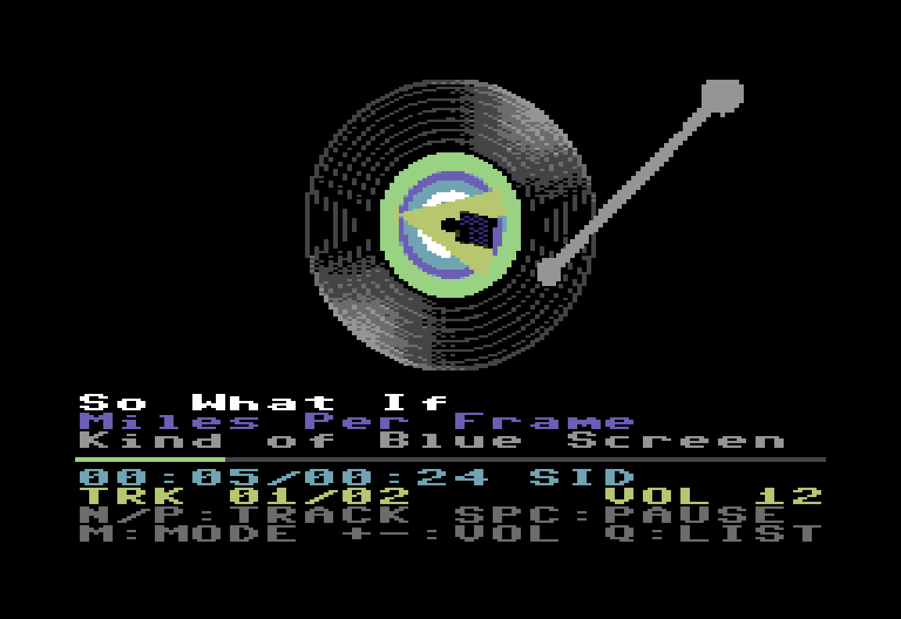

<div align="center">

# SIDVinyl

**A Navidrome/Subsonic frontend for the Commodore 64 — a spinning vinyl with the real album cover**<br>
**Un frontend Navidrome/Subsonic para Commodore 64: un vinilo girando con la portada real del álbum**

[](LICENSE)



[**English**](#english) · [**Español**](#español)

</div>

---

# English

> Browse and play your [Navidrome](https://www.navidrome.org) library (or any
> Subsonic-compatible server) on a C64 with an **Ultimate 64 / Ultimate-II+**, or in
> **VICE**.

The C64 shows your albums, a vinyl record spinning with the real cover art as its
label, and plays the music through the SID. A small Python **bridge** talks to the
server, converts the covers and encodes the audio, because the C64 itself speaks no
HTTP.

## Contents

- [Audio modes](#audio-modes)
- [Architecture](#architecture)
- [Usage](#usage)
- [VICE (no Ultimate)](#vice-no-ultimate)
- [Keys](#keys)
- [Build and test](#build-and-test)
- [How SID mode works](#how-sid-mode-works)
- [Limitations](#limitations)
- [Protocol](#protocol)
- [License](#license)

## Audio modes

Two modes, switchable on the fly with `M`:

| Mode | What it does |
|------|--------------|
| **DIGI** | Real streaming: 8 kHz, 4 bits through the SID master volume (CIA2 NMI), with noise shaping and normalisation. |
| **SID** | Chiptune conversion with a buffer and ~1.5 s of *look-ahead*: voice 1 bass, voice 2 lead, voice 3 harmony + drums. Pitch by Viterbi over harmonic salience, segmented notes, real per-note dynamics and waveform chosen from the timbre. Approximate, but recognisable. |

## Architecture

```
C64 (PRG, 6502) ──UCI/TCP (Ultimate)──┐
                 └─ACIA 6551 serial (VICE)─┴► bridge (Python) ──HTTP──► Navidrome / Subsonic
                              └─ ffmpeg: decodes; DIGI encoder or SID analysis → SID registers
```

The same PRG serves both links: on start-up it checks for the UCI (`$DF1D` = `$C9`) and
falls back to serial if it is absent. On the title screen `F1` switches the link by hand.

The C64 does not speak HTTP. The Ultimate command interface (UCI, `$DF1C-$DF1F`) opens
a TCP socket to the *bridge*, which acts as the gateway: Subsonic token auth,
`getAlbumList2`, `getAlbum`, `getCoverArt`, `stream`. It also converts each cover into
32 frames of a rotating label (multicolour bitmap) and sends the audio.

## Usage

1. **Ultimate**: Settings → *C64 and Cartridge Settings* / *Command Interface* → enable
   *Command Interface* and connect the Ultimate to the network.
2. **Bridge** (on a PC/Raspberry with `python3`, `numpy`, `Pillow` and `ffmpeg`):
   ```
   python3 bridge/sidvinyl_bridge.py --server http://navidrome:4533 --user me --password secret
   # or the NAVIDROME_URL / NAVIDROME_USER / NAVIDROME_PASSWORD variables
   # try it without a server:  python3 bridge/sidvinyl_bridge.py --demo
   ```
   It listens on port 6464 (`--host`/`--port`; `--insecure` for self-signed TLS).
3. **PRG**: `c64/sidvinyl.prg` (load it with `LOAD"*",8,1` or from the Ultimate file
   browser, then `RUN`). Type the bridge address on the title screen. To set the default one:
   ```
   python3 tools/patch_host.py c64/sidvinyl.prg 192.168.1.50:6464
   python3 tools/send_prg.py c64/sidvinyl.prg ULTIMATE_IP      # optional, over REST
   ```

## VICE (no Ultimate)

VICE does not emulate the UCI, but it does emulate a 6551 ACIA (SwiftLink) that can
connect to the bridge over TCP:
```
python3 bridge/sidvinyl_bridge.py --demo            # (or with --server ...)
python3 tools/patch_host.py c64/sidvinyl.prg 127.0.0.1:6464
x64sc -acia1 -acia1mode 1 -acia1base 0xDE00 -acia1irq 0 -myaciadev 0 \
      -rsdev1 127.0.0.1:6464 -rsdev1baud 19200 -autostartprgmode 1 -autostart c64/sidvinyl.prg
```
Serial runs at 19200 baud with no hardware flow control, so the bridge uses credit-based
flow control (`CMD_CREDIT`) and DIGI audio drops to **3.5 kHz** (the ACIA is polled from
the timer NMI; at 38400 the VIC cycle stealing lost bytes). SID mode is unaffected. The
cover (≈20 KB) takes ~11 s to arrive (first audio ≈20 s in VICE). With VICE, a binary
monitor connection blocks the keys. There is no connection-loss detection over serial.

## Keys

| Screen | Keys |
|--------|------|
| Albums | `↑/↓` move (turns the page at the edges), `←/→` page, `RETURN` play, `S` sort (A-Z album/artist, newest, most played, random, favourites) |
| Playing | `N`/`→` next, `P`/`←` previous, `SPACE` pause, `M` DIGI/SID mode, `+`/`-` volume, `Q`/`STOP` back to the list |

Joystick in port 2: directions + fire = RETURN.

## Build and test

```
c64/build.sh                 # needs cc65 (ca65/ld65); CC65_BIN=/path/bin if not in PATH
python3 tests/test_audio.py  # DIGI/SID encoders (SID: bass/lead accuracy and drum hits)
python3 tests/test_bridge.py # bridge protocol end to end (demo library)
python3 tests/test_c64.py    # the real PRG in a C64+UCI simulator (py65) against the real bridge
TRANSPORT=serial python3 tests/test_c64.py   # same over the 6551 ACIA (detects overruns)
python3 tests/test_vice.py   # the real PRG in VICE x64sc (Xvfb) over ACIA/TCP; see the script header
```

`tools/c64sim.py` emulates the 6510, VIC-II (raster IRQ, text/bitmap/sprite rendering),
CIA1 (keyboard), CIA2 (NMI) and the UCI over real sockets; screenshots go to
`/tmp/sidvinyl_out`. `tests/sidrender.py` renders SID frames back to audio so you can
compare the encoder's output by ear or objectively.

## How SID mode works

The analysis lives in `bridge/sidenc.py`. A worker thread in the bridge (`SidStream`)
decodes and analyses the track ahead of playback, queues up to 30 s of frames, and the
session pops them at playback rate.

- **Pitch**: harmonic-sum salience on a 1/3-semitone grid, then a Viterbi path over time
  (stable notes, vibrato kept, octave jumps penalised). Bass, lead and harmony are found
  one after another, each masking the harmonics of the previous ones so they do not
  double up.
- **Notes**: pitch tracks are cut into notes; a re-attack (amplitude jump) retriggers the
  gate, a legato pitch change does not.
- **Dynamics**: the envelope runs with attack = decay = 0 and the sustain nibble is
  rewritten every frame with the loudness of the note, so the SID follows the real
  amplitude contour instead of a fixed ADSR.
- **Waveform**: chosen per note from the measured harmonic profile (sine-like → triangle,
  odd harmonics → pulse, bright → sawtooth).
- **Drums**: onset detection with adaptive thresholds in three bands, played on voice 3
  as noise / triangle sweeps.
- **Volume**: applied by the bridge when frames are sent, not in the encoder.

## Limitations

- Verified in the simulator and in VICE 3.7.1 (connection, listing, both modes, pause,
  volume, next/previous, back to the menu, PAL). The UCI follows the Ultimate
  documentation; if a timing detail differs on your hardware, `c64/uci.s` is the only
  place to adjust.
- SID mode is an approximation with 3 voices; it works best with sparse music. When a
  track starts or the mode changes there is a ~1 s delay while the analysis buffer fills.
- DIGI audio at 4 bits / 8 kHz: "period" quality.
- Volume acts in the bridge: with audio already queued it takes ~1 s to be noticed; while
  paused the bridge keeps sending until the TCP buffer is full.
- Only 20 albums are shown per page, and text is transliterated to ASCII (no accents).
- PAL and NTSC are detected automatically.

## Protocol

C64→bridge commands: `HELLO 01 (id, video, version, transport), LIST 02, PLAY 03,
NEXT 04, PREV 05, MODE 07, VOL 08, STOP 09, CREDIT 0A` (serial only: 8-byte units).

Bridge→C64 packets: `[type][len lo][len hi][payload]` with types HELLO, LIST, TRACK,
COVER (32×640 B), DIGI (nibbles), SID (22 B/frame: 3 voices × 7 registers + volume),
STOP, ERROR, VOL, DISC (static disc + tonearm sprites). See `bridge/protocol.py`.

## License

[MIT](LICENSE) © 2026 advenacodex

[](https://ko-fi.com/advenacodex)

---

# Español

> Navega y reproduce tu biblioteca de [Navidrome](https://www.navidrome.org) (o de
> cualquier servidor compatible con Subsonic) en un C64 con **Ultimate 64 /
> Ultimate-II+**, o en **VICE**.

El C64 muestra tus álbumes, un vinilo girando con la portada real como etiqueta, y
reproduce la música por el SID. Un pequeño **bridge** en Python habla con el servidor,
convierte las portadas y codifica el audio, porque el C64 no habla HTTP.

## Contenido

- [Modos de audio](#modos-de-audio)
- [Arquitectura](#arquitectura)
- [Uso](#uso)
- [VICE (sin Ultimate)](#vice-sin-ultimate)
- [Teclas](#teclas)
- [Compilar y probar](#compilar-y-probar)
- [Cómo funciona el modo SID](#cómo-funciona-el-modo-sid)
- [Limitaciones](#limitaciones)
- [Protocolo](#protocolo)
- [Licencia](#licencia)

## Modos de audio

Dos modos, conmutables en caliente con `M`:

| Modo | Qué hace |
|------|----------|
| **DIGI** | Streaming real: 8 kHz, 4 bits por el volumen del SID (NMI de CIA2), con noise shaping y normalización. |
| **SID** | Conversión a chiptune con buffer y *look-ahead* (~1,5 s): voz 1 bajo, voz 2 melodía, voz 3 armonía + batería. Tono por Viterbi sobre saliencia armónica, notas segmentadas, dinámica real por nota y forma de onda según el timbre. Aproximado, pero reconocible. |

## Arquitectura

```
C64 (PRG, 6502) ──UCI/TCP (Ultimate)──┐
                 └─ACIA 6551 serie (VICE)─┴► bridge (Python) ──HTTP──► Navidrome / Subsonic
                              └─ ffmpeg: decodifica; codificador DIGI o análisis SID → registros SID
```

El mismo PRG sirve para ambos enlaces: al arrancar detecta si existe UCI (`$DF1D` =
`$C9`); si no, usa el enlace serie. En la pantalla inicial `F1` conmuta el enlace a mano.

El C64 no habla HTTP. La interfaz de comandos de Ultimate (UCI, `$DF1C-$DF1F`) abre un
socket TCP contra el *bridge*, que hace de pasarela: auth Subsonic con token,
`getAlbumList2`, `getAlbum`, `getCoverArt`, `stream`. Además convierte cada portada a 32
fotogramas de etiqueta giratoria (bitmap multicolor) y envía el audio.

## Uso

1. **Ultimate**: Settings → *C64 and Cartridge Settings* / *Command Interface* → habilita
   *Command Interface* y conecta la Ultimate a la red.
2. **Bridge** (en un PC/Raspberry con `python3`, `numpy`, `Pillow` y `ffmpeg`):
   ```
   python3 bridge/sidvinyl_bridge.py --server http://navidrome:4533 --user yo --password secreto
   # o variables NAVIDROME_URL / NAVIDROME_USER / NAVIDROME_PASSWORD
   # prueba sin servidor:  python3 bridge/sidvinyl_bridge.py --demo
   ```
   Escucha en el puerto 6464 (`--host`/`--port`; `--insecure` para TLS autofirmado).
3. **PRG**: `c64/sidvinyl.prg` (se carga con `LOAD"*",8,1` o desde el explorador de la
   Ultimate, y `RUN`). La dirección del bridge se teclea en la pantalla inicial. Para fijar
   la de por defecto:
   ```
   python3 tools/patch_host.py c64/sidvinyl.prg 192.168.1.50:6464
   python3 tools/send_prg.py c64/sidvinyl.prg IP_DE_LA_ULTIMATE      # opcional, vía REST
   ```

## VICE (sin Ultimate)

VICE no emula el UCI, pero sí una ACIA 6551 (SwiftLink) que puede conectarse por TCP al
bridge:
```
python3 bridge/sidvinyl_bridge.py --demo            # (o con --server ...)
python3 tools/patch_host.py c64/sidvinyl.prg 127.0.0.1:6464
x64sc -acia1 -acia1mode 1 -acia1base 0xDE00 -acia1irq 0 -myaciadev 0 \
      -rsdev1 127.0.0.1:6464 -rsdev1baud 19200 -autostartprgmode 1 -autostart c64/sidvinyl.prg
```
En serie: 19200 baudios, sin control de flujo hardware, así que el bridge usa control de
flujo por créditos (`CMD_CREDIT`) y el audio DIGI baja a **3,5 kHz** (la ACIA se sondea
desde la NMI del temporizador; a 38400 los robos de ciclos del VIC provocaban pérdida de
bytes). SID no se ve afectado. La portada (≈20 KB) tarda ~11 s en llegar (primer audio
≈20 s en VICE). Con VICE, una conexión del monitor binario bloquea las teclas. No hay
detección de pérdida de conexión en serie.

## Teclas

| Pantalla | Teclas |
|----------|--------|
| Álbumes | `↑/↓` mover (pasa de página en los bordes), `←/→` página, `RETURN` reproducir, `S` orden (A-Z álbum/artista, nuevos, más oídos, aleatorio, favoritos) |
| Reproduciendo | `N`/`→` siguiente, `P`/`←` anterior, `ESPACIO` pausa, `M` modo DIGI/SID, `+`/`-` volumen, `Q`/`STOP` volver a la lista |

Joystick en el puerto 2: direcciones + fuego = RETURN.

## Compilar y probar

```
c64/build.sh                 # requiere cc65 (ca65/ld65); CC65_BIN=/ruta/bin si no está en PATH
python3 tests/test_audio.py  # codificadores DIGI/SID (SID: acierto de bajo/melodía y golpes de batería)
python3 tests/test_bridge.py # protocolo bridge de extremo a extremo (biblioteca demo)
python3 tests/test_c64.py    # el PRG real en un simulador C64+UCI (py65) contra el bridge real
TRANSPORT=serial python3 tests/test_c64.py   # idem con la ACIA 6551 (detecta overruns)
python3 tests/test_vice.py   # el PRG real en VICE x64sc (Xvfb) vía ACIA/TCP; ver cabecera del script
```

`tools/c64sim.py` emula 6510, VIC-II (IRQ de raster, render texto/bitmap/sprites), CIA1
(teclado), CIA2 (NMI) y UCI sobre sockets reales; las capturas quedan en
`/tmp/sidvinyl_out`. `tests/sidrender.py` renderiza los frames SID de vuelta a audio para
comparar la salida del codificador, de oído o de forma objetiva.

## Cómo funciona el modo SID

El análisis está en `bridge/sidenc.py`. Un hilo del bridge (`SidStream`) decodifica y
analiza la pista por delante de la reproducción, encola hasta 30 s de frames, y la sesión
los consume al ritmo de reproducción.

- **Tono**: saliencia por suma armónica en una rejilla de 1/3 de semitono, y después un
  camino de Viterbi en el tiempo (notas estables, vibrato conservado, saltos de octava
  penalizados). Bajo, melodía y armonía se buscan uno tras otro, enmascarando cada uno los
  armónicos de los anteriores para que no se dupliquen.
- **Notas**: las pistas de tono se cortan en notas; un nuevo ataque (salto de amplitud)
  redispara la puerta, un cambio de tono ligado no.
- **Dinámica**: la envolvente corre con ataque = decay = 0 y el nibble de sustain se
  reescribe en cada frame con la sonoridad de la nota, de modo que el SID sigue el
  contorno real de amplitud en lugar de un ADSR fijo.
- **Forma de onda**: se elige por nota según el perfil armónico medido (parecido a seno →
  triángulo, armónicos impares → pulso, brillante → diente de sierra).
- **Batería**: detección de ataques con umbrales adaptativos en tres bandas, tocada en la
  voz 3 como barridos de ruido / triángulo.
- **Volumen**: lo aplica el bridge al enviar los frames, no el codificador.

## Limitaciones

- Verificado en el simulador y en VICE 3.7.1 (conexión, listado, ambos modos, pausa,
  volumen, siguiente/anterior, volver al menú, PAL). El UCI sigue la documentación de
  Ultimate; si algún detalle de timing difiere en tu hardware, `c64/uci.s` es el único
  sitio a ajustar.
- Modo SID: aproximación con 3 voces; funciona mejor con música poco densa. Al empezar
  una pista o cambiar de modo hay ~1 s de retardo mientras se llena el buffer de análisis.
- Audio DIGI a 4 bits/8 kHz: calidad "de época".
- El volumen actúa en el bridge: con audio ya en cola tarda ~1 s en notarse; en pausa el
  bridge sigue enviando hasta llenar el buffer TCP.
- Solo se muestran 20 álbumes por página, y los textos se transliteran a ASCII (sin
  acentos).
- PAL y NTSC se detectan automáticamente.

## Protocolo

Comandos C64→bridge: `HELLO 01 (id, vídeo, versión, transporte), LIST 02, PLAY 03,
NEXT 04, PREV 05, MODE 07, VOL 08, STOP 09, CREDIT 0A` (solo serie: unidades de 8 bytes).

Paquetes bridge→C64: `[tipo][len lo][len hi][payload]` con tipos HELLO, LIST, TRACK,
COVER (32×640 B), DIGI (nibbles), SID (22 B/frame: 3 voces × 7 registros + volumen), STOP,
ERROR, VOL, DISC (disco estático + sprites del brazo). Ver `bridge/protocol.py`.

## Licencia

[MIT](LICENSE) © 2026 advenacodex

[](https://ko-fi.com/advenacodex)
